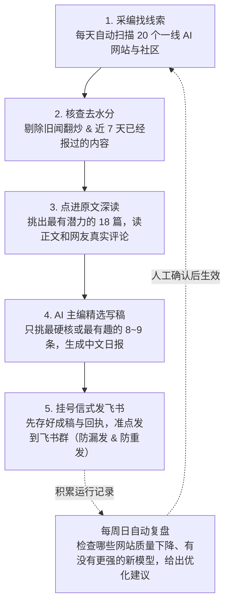

# AI Frontier Daily：一个全自动运转的“AI 情报编辑部”

> **一句话介绍**：这是一个开源、免费运行的每日 AI 日报系统。它像一个 **24 小时在线的 6 人编辑部**——每天早上自动逛完 20 个一线 AI 网站、点进去读原文、由大模型精选总结，再准点以精美卡片发到飞书群，而且**不用买服务器、不用人工盯盘、每周还会自己复盘进化**。

---

## 一张图看懂它每天怎么工作

---

## 它厉害在哪里？（6 个通俗亮点）

### 1. 不用买服务器，也不容易“跑坏”
- **解决什么问题**：很多自动化工具需要租云服务器、装一堆插件，过几个月插件更新就报错罢工。
- **我们怎么做**：整个项目只用了 Python 自带的基础能力（**零第三方依赖**），直接托管在 GitHub 上定时运行，**零服务器费用**，开箱即用，长期运行非常稳定。

### 2. 专治“旧闻翻炒”和“连续几天刷到同一件事”
- **解决什么问题**：很多新闻聚合工具只会看发帖时间，经常把几个月前的旧论文或昨天刚看过的热点换个标题再推一遍。
- **我们怎么做**：
  - **追查源头时间**：不只看转发时间，还会从网址日期、论文编号、网页元数据里挖出这件事**真正发生的时间**，老新闻直接拦截。
  - **7 天记忆本**：系统自带一份 7 天已发记录，哪怕今天换了另一家媒体报道同一个开源项目或软件版本，也能识别出来不再重复推送。

### 3. 不当“标题党搬运工”，真的会点进去读原文和评论
- **解决什么问题**：只把标题和两行简介扔给 AI 总结，写出来的日报往往很空洞，全是套话。
- **我们怎么做**：
  - 系统会把排名前 18 的候选文章**真正点进去抓出正文**，顺手提取开源仓库地址、安装命令，还会去抓 Hacker News 上一线开发者的真实吐槽和评价。
  - 选品时不搞“每个栏目必须凑满 3 条”的死板配额，而是**宁缺毋滥**——只要一篇文章在「技术够硬核」「脑洞够有趣」「行业影响够大」任意一方面特别突出，就会高分入选。

### 4. AI 模型偶尔抽风也不怕：换备胎 → 补考 → 兜底简报
- **解决什么问题**：在线大模型接口偶尔会超时、限流，或者输出格式错乱，导致日报直接断更。
- **我们怎么做**：
  - **自动切备胎**：主模型一旦抽风或返回乱码，立刻自动重试并切换备用模型。
  - **两轮保险策略**：早上 **10:23** 主跑如果所有模型都挂了，先不凑合发低质量内容，等 **10:47** 再重试一次完整版；万一到 10:47 模型还是全挂，系统会自动发一份明确标明「⚠️ 降级短报」的规则精选版，保证绝不断更。

### 5. 像寄“挂号信”一样推飞书：不漏发，也不重复刷屏
- **解决什么问题**：定时任务失败重试时，最容易出现“刚才其实发出去了但没记下来，重试又发一遍刷屏”，或者“失败了但没人知道”。
- **我们怎么做**：
  - **先写稿存档，再动手发**：每天生成的日报会先存进一个专门记账的小本本（独立的状态分支），发出成功后盖上“已送达”回执章。
  - **自带防重编号**：发给飞书的每期日报都带一个唯一编号；如果网络抖动触发了 10:47 补发，系统会**直接复用之前写好的那篇稿子**和**同一个编号**，既不花冤枉钱重跑 AI，飞书也会自动防止重复刷屏。
  - **超时主动报警**：如果到了 **11:15** 还没收到“已送达”确认，外部监控会自动发邮件提醒，避免静默漏发。

### 6. 每周自己复盘进化，但绝不“擅自乱改”
- **解决什么问题**：AI 领域变化太快，信源会失效、新模型会不断发布、读者的关注点也会变。
- **我们怎么做**：
  - 每周日下午系统会独立跑一次“体检”：一方面自动探测有没有更新更强的模型版本；另一方面根据历史命中率和你留下的阅读反馈，建议停用老报错的网站、给好网站加权、补充新的热门关键词。
  - **安全护栏**：它只输出一份“建议清单”，**绝不会自己偷偷改线上配置**；你看过满意后一键应用，不满意也能随时一键撤回。

---

## 每天 & 每周的实际运转时间表

| 时间（北京时间） | 系统在做什么 | 效果 |
| :--- | :--- | :--- |
| **每天 10:23** | 正式开跑：抓 20 个源 → 读原文 → AI 写稿 → 发飞书群 | 正常情况下此时已经收到精美飞书卡片 |
| **每天 10:47** | 自动复查回执：已发出就跳过；失败则直接补发原稿 | 兜底防漏发，且绝不重复刷屏 |
| **每天 11:15** | 外部监控截止点：若还没收到成功确认，自动发告警邮件 | 彻底告别“默默挂了好几天才发现” |
| **每周日 15:30** | 独立运行周度体检：探测新模型 + 生成信源与偏好优化建议 | 系统越用越懂你，且不影响每天发报 |
